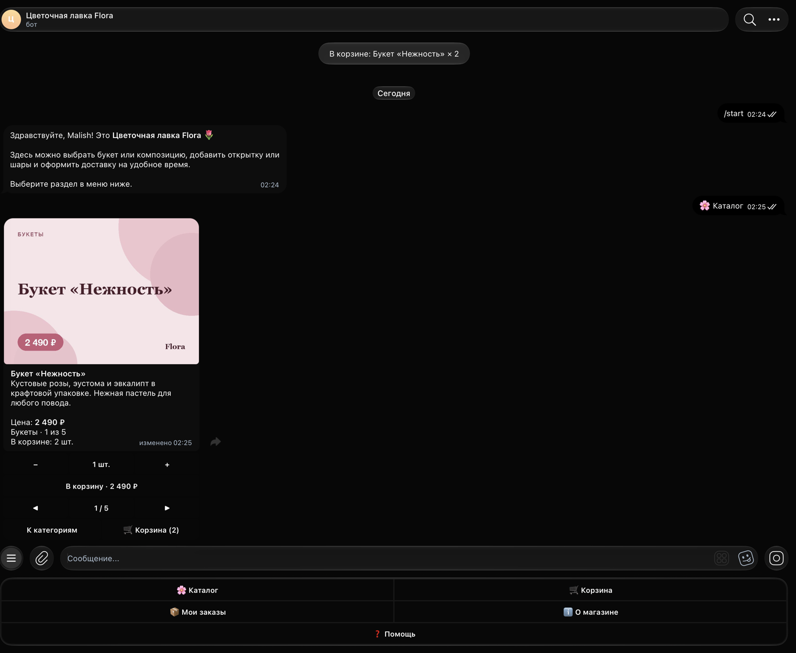
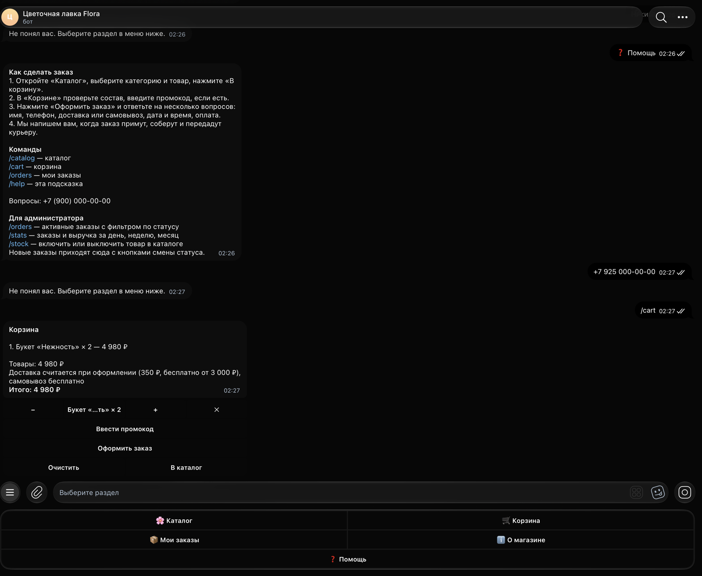
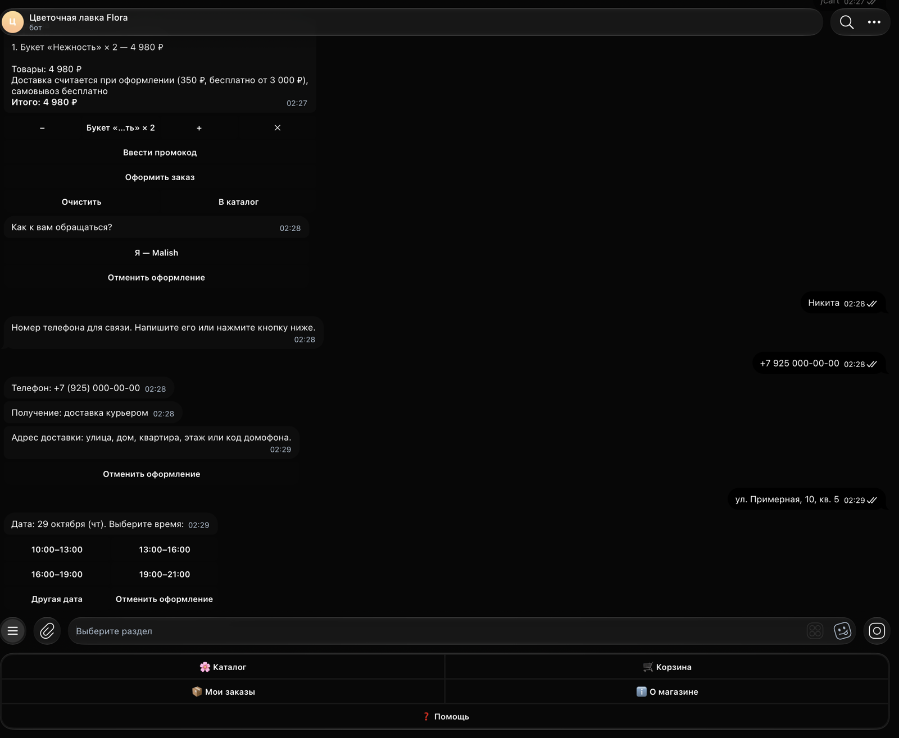
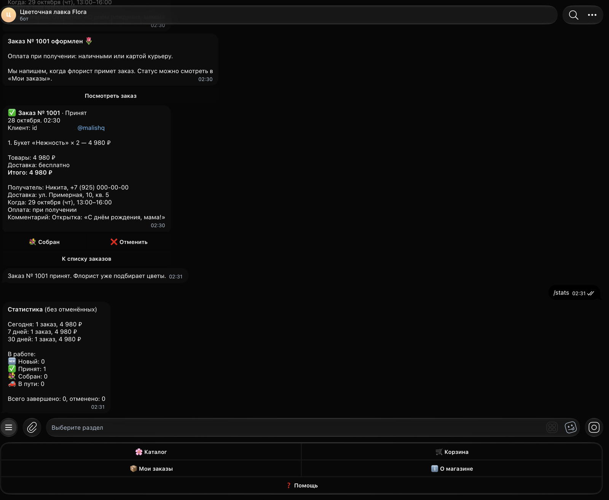

# Flora — Telegram-бот цветочного магазина

Бот принимает заказы на букеты, композиции и растения: каталог с карточками, корзина с промокодами, оформление с выбором даты и интервала доставки, уведомления о статусе и панель администратора прямо в Telegram.

Демо: [@flora_shop_demo_bot](https://t.me/flora_shop_demo_bot) (отвечает, пока запущен демо-сервер).

Демо для портфолио: компания вымышленная, цены и имена — примеры.

## Что умеет

Покупатель:

- `/start` — приветствие и меню: Каталог, Корзина, Мои заказы, О магазине, Помощь.
- Каталог по категориям: букеты, композиции в коробке, горшечные растения, дополнительно (открытка, ваза, шары). Карточка товара — фото, описание, цена, выбор количества, кнопка «В корзину», листание внутри категории. Всё в одном сообщении, которое редактируется, а не присылается заново.
- Корзина: количество «+ / −», удаление позиции, очистка, итог, промокод (процент или фиксированная скидка, порог суммы).
- Оформление заказа по шагам: имя (с подстановкой из прошлого заказа), телефон (ввод или кнопка «Отправить мой номер», проверка формата), доставка или самовывоз, адрес, дата (ближайшие 7 дней) и интервал времени (интервалы на сегодня отсекаются с учётом запаса), комментарий, способ оплаты (при получении или переводом с инструкцией), итоговая сводка и подтверждение. Бесплатная доставка от заданной суммы.
- Номер заказа, уведомления при каждой смене статуса: новый → принят → собран → в пути → доставлен (для самовывоза — выдан), отдельно «отменён».
- «Мои заказы»: список, детали, «Повторить заказ» (товары снова в корзине).

Администратор (id из `ADMIN_IDS`):

- Новый заказ приходит сообщением с составом, контактами и кнопками смены статуса. Переходы проверяются, покупатель получает уведомление.
- `/orders` — активные заказы с фильтром по статусу, открытие любого заказа.
- `/stats` — число заказов и выручка за день, 7 и 30 дней, сколько заказов в работе.
- `/stock` — включить или выключить товар в каталоге по категориям.

Служебное: регистрация команд и описания бота при старте, обработчик ошибок с логированием, корректная остановка по Ctrl+C, SQLite через aiosqlite (товары, корзины, заказы, позиции, пользователи).

## Команды

| Команда | Кто | Что делает |
|---|---|---|
| `/start` | все | главное меню |
| `/catalog` | все | каталог |
| `/cart` | все | корзина |
| `/orders` | покупатель | мои заказы |
| `/help` | все | подсказка (администратору — с его командами) |
| `/orders` | администратор | активные заказы с фильтром |
| `/stats` | администратор | статистика за день, неделю, месяц |
| `/stock` | администратор | наличие товаров |

## Стек

Python 3.9+, aiogram 3.22, aiosqlite, python-dotenv, Pillow (генерация карточек), pytest. Docker и systemd для развёртывания.

## Скриншоты

<!-- screens -->








## Запуск

Локально:

```bash
pip install -r requirements.txt
cp .env.example .env    # вписать BOT_TOKEN от @BotFather и ADMIN_IDS
python main.py
```

В Docker:

```bash
cp .env.example .env
docker compose up -d --build
```

База хранится в `data/flora.db` (в Docker — том `./data`). Каталог подгружается из `data/catalog.json` при каждом старте: названия, описания и цены обновляются, флаг наличия сохраняется.

На VPS через systemd: положить проект в `/opt/flower-shop-bot`, создать там venv и `.env`, затем

```bash
sudo cp deploy/flower-shop-bot.service /etc/systemd/system/
sudo systemctl enable --now flower-shop-bot
journalctl -u flower-shop-bot -f
```

Тесты (без сети): `pytest`. Проверяются суммы корзины и промокоды, валидация телефона, формирование интервалов доставки, допустимые переходы статусов, форматирование и работа с базой.

## Как адаптировать под магазин

- Товары и категории — `data/catalog.json` (id, категория, название, описание, цена, порядок). Картинки карточек — `assets/catalog/<slug>.png`, 800×600. Свои фото кладутся под теми же именами; плашки-заглушки перерисовываются командой `python scripts/make_catalog_images.py` (палитры категорий — в начале скрипта).
- Настройки — `.env`: название, адрес, часы, телефон магазина, стоимость доставки и порог бесплатной, интервалы доставки и запас времени (`ORDER_LEAD_HOURS`), горизонт дат (`ORDER_DAYS_AHEAD`), лимит количества, промокоды (`КОД:10%` или `КОД:300:2000` — скидка 300 ₽ от 2 000 ₽), реквизиты для оплаты переводом, смещение часового пояса.
- Тексты приветствия, справки и раздела «О магазине» — `bot/texts.py`; сообщения о статусах — `bot/services/statuses.py`; подписи кнопок — `bot/keyboards.py`.
- Статусы и разрешённые переходы — `bot/services/statuses.py`. Логика сумм, промокодов, телефонов и интервалов — `bot/services/`, она не зависит от Telegram и покрыта тестами.
- Чтобы подключить онлайн-оплату, достаточно заменить ветку «переводом» в `bot/handlers/checkout.py` на создание счёта.

## Картинки

Все изображения карточек сгенерированы кодом (`scripts/make_catalog_images.py`, Pillow): цветная плашка с названием и ценой. Сторонних картинок и шрифтов в репозитории нет. Примерные данные: названия товаров, цены, адрес, телефон и реквизиты в `.env.example` и `data/catalog.json`.
